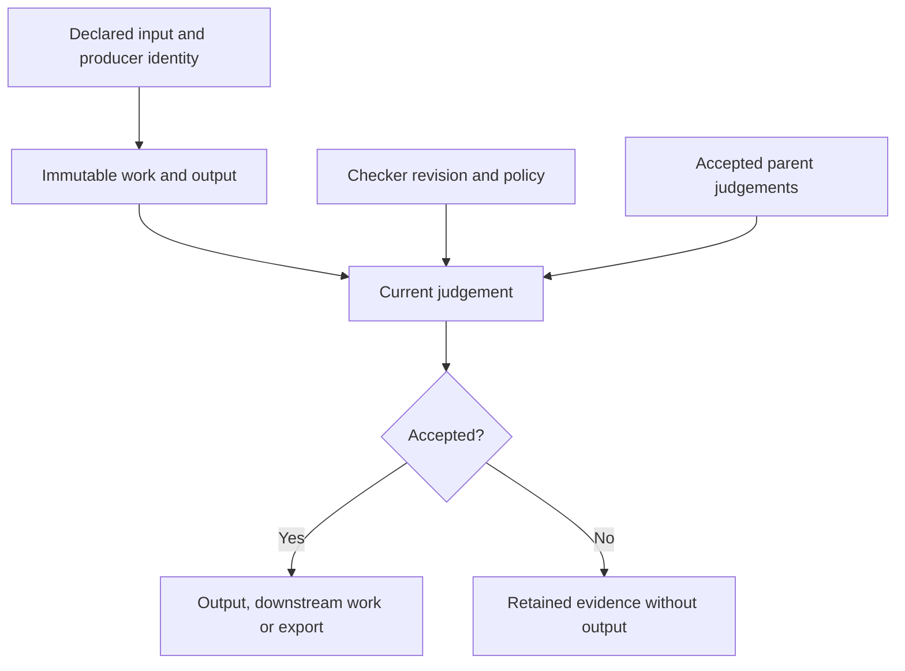

# Architecture and invariants

## Computation and acceptance have different identities

A work record contains an immutable input envelope and one immutable output.
Its key is SHA-256 of the canonical envelope:

```text
work = {schema, scope, stage, producer: {revision, model_config}, input, parents}
```

`parents` is an ordered list of unique parent work keys. Each key binds one
stored output, so the child's identity binds those exact parent results. The
producer receives copies of parent outputs, without their judgement metadata.

A judgement has its own identity:

```text
judgement = {schema, work_key, output_digest, verifier: {revision, policy}, parents}
```

Here `parents` contains the current parent **judgement** keys in the same order.
The stored verdict contains an exact Boolean, a nonempty reason and JSON evidence.
Including `work_key` prevents two different questions with the same candidate
output from sharing an acceptance decision.

The work and judgement tables are append-only through this API. A repeated
identical write is idempotent. A different record under an existing key is refused.
These properties apply to this implementation, not to a malicious database writer.



## Invalidation rules

| Change or observation | Generation | Acceptance |
|---|---|---|
| Same declared input, producer and accepted dependency closure | Reuse stored output | Reuse identical current judgement |
| New input/source snapshot | New work key | Check new output |
| New producer revision or model configuration | New work key; old record is stale under the new registry | Check new output |
| New checker revision or policy | Reuse stored output | Create a new judgement |
| Parent remains accepted under a new judgement | Reuse child output | Recheck child using current parent judgement identities |
| Parent becomes rejected, stale, missing or corrupt | Do not produce a new child | Block even a previously accepted cached child |
| Checker raises or process exits after generation commit | Reuse completed generation on retry | Retry the check; no failed check becomes acceptance |
| Stored evidence fails integrity checks | Do not silently regenerate or overwrite it | Return a diagnostic without output |

The engine's registry is fixed for its lifetime. Reopen it with a changed policy
or checker identity when acceptance changes. The engine cannot know that an
external source, remote model or undeclared closure variable changed. Supply a
new source snapshot or revision. Explicit `fingerprint_files()` manifests can
cover source, prompts and dependency lock files; they do not discover dependencies.

Checkers must be deterministic over the declared snapshots and policy. An
unchanged checker identity permits its existing judgement to be reused. A
verifier which secretly reads the clock or a live website violates this contract.
Callbacks must not reenter the same engine or perform external business actions.
Only the declared `effect="pure"` category is admitted in this version.

## Admission, persistence and restart

Before calling a producer, the Store atomically reserves an attempt and charges
the durable producer-call budget. Completed generation and the attempt's
completion status are committed together with SQLite `synchronous=FULL`.
Verification runs after that commit.

If the process exits inside the verifier, its output already exists and can be
rechecked after reopening. If it exits before the output commit, the next owner
marks the running attempt interrupted. Its cost remains counted, and another
attempt may be necessary. This is restart-safe reuse of durably completed work,
not exactly-once execution of an external action.

A separate SQLite connection holds an exclusive transaction on a sidecar for
the Store lifetime. Another cooperating owner using the same canonical path is
refused. Process termination releases the operating-system lock automatically.
The main connection uses a reentrant lock and explicit transactions. Unknown
schema versions, foreign databases and invalid counters are refused without a
reset. This assumes a local filesystem and cooperating users.

Within one engine, a fixed set of work locks prevents concurrent duplicate
generation while bounding lock bookkeeping. A reentrant validation lock checks
the complete dependency closure under the fixed registry snapshot. Producer
callbacks run outside that validation lock; checker calls are serialised.

Close stops admission, waits for all admitted calls and then releases the Store.
An interruption while draining keeps admission stopped and the lease held; a
subsequent close can take responsibility for finishing shutdown.
Already admitted calls can complete even when a client disconnects or stops
waiting. A nonterminating callback can therefore keep close waiting. This is an
explicit limitation, not a forced timeout or a subprocess sandbox.

## Default application limits

| Limit | Default | Scope |
|---|---:|---|
| Complete work envelope or judgement context | 65,536 encoded bytes each | Includes identity metadata and configuration/policy |
| Output | 1,048,576 encoded bytes | Per stored output |
| Complete verdict | 65,536 encoded bytes | Per judgement |
| Work records plus active reservations | 256 | Durable Store admission |
| Judgement records | 2,048 | Durable Store |
| Producer attempts | 1,024 | Durable Store, including failed/interrupted attempts |
| Parents | 32 | Unique ordered references per record |
| Dependency depth | 32 | Complete validation/export path |
| Stream items | 10,000 | Per stream |
| Active operations / stream workers | 4 | Per engine |
| Pending stream window | 8 | Per stream |

The stream consumes at most its pending window before waiting. At the item cap,
one unsubmitted lookahead distinguishes an exhausted iterator from overflow.
Overflow is reported; already admitted items may have completed. Inputs are
copied when submitted, including iterators that reuse a mutable dictionary.

Lower limits never delete existing evidence or reset attempt counters. An
operator can deliberately raise limits or select another store. These are not
account-wide billing controls. Per-engine callback counters reset on reopen;
the Store's `attempts_total` and record counts persist.

Limits bound logical records and admission. They do not bound arbitrary callback
allocations, SQLite journal overhead, operating-system resources or every
encoder allocation. See [SECURITY.md](../SECURITY.md).

## JSON and portable bundles

The encoding uses sorted object keys, UTF-8, compact separators and Python's JSON
number representation. It accepts exact builtin JSON types, rejects duplicate
keys on decoding, rejects nonfinite floats and invalid Unicode, distinguishes
Booleans/integers/floats and limits nesting/nodes. It is versioned Python-specific
encoding, not a claim of RFC 8785 or universal cross-language canonicalisation.

`Engine.export(roots)` revalidates every requested root and its dependency closure.
If any root fails, export is refused. The bundle includes complete work and current
accepted judgement records, explicit roots, a scope and a manifest digest.
Unrelated quarantined records are not exported.

`verify_bundle()` checks exact schemas, record identities, output digests, one
accepted judgement per work, parent judgement bindings, registry consistency and
the complete root closure. It rejects missing or unrelated evidence and cycles.
It does not execute a checker, determine current external policy, authenticate a
source or establish authorship. An accepted historical bundle remains historical
when an external policy changes.

`inspect()` is a read of historical metadata. It returns neither the stored input
nor the output and does not create a judgement. The MCP `recheck_work` tool is
separate because revalidation can write new evidence.
